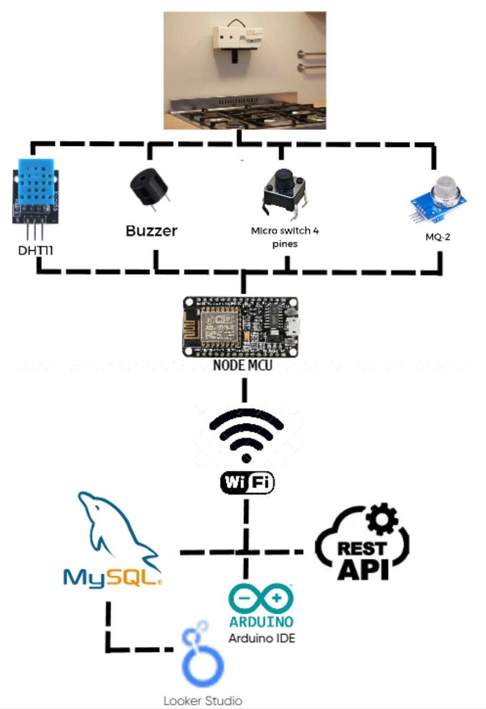
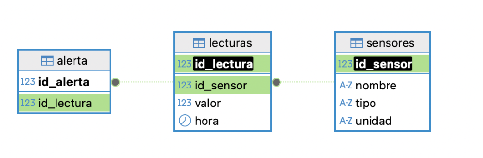
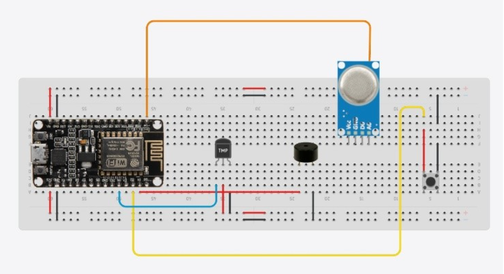

# Home Guardian

Sistema IoT de monitoreo ambiental para la seguridad del hogar. Detecta gas y temperatura elevada en la cocina, activa una alarma sonora de inmediato y guarda las lecturas en una base de datos a través de una API REST.

> Proyecto académico del curso Implementación de internet de las cosas, Tecnológico de Monterrey. Desarrollado en equipo (5 integrantes).

## Qué hace

- Lee temperatura y humedad (DHT11) y concentración de gas (MQ-2) de forma continua.
- Enciende un LED cuando el NodeMCU se conecta a internet y está en línea.
- Activa un buzzer cuando una lectura supera su umbral: gas > 500 o temperatura > 45 °C.
- La alarma sigue sonando hasta que el usuario presiona el botón de apagado.
- Envía cada lectura por HTTP POST a la API, que la guarda en MySQL. Al apagar la alarma, registra también la lectura que la disparó y una alerta.
- Ofrece una ruta HTML que muestra las lecturas en una tabla.

## Arquitectura



Sensores → NodeMCU ESP8266 (Wi-Fi) → API REST (Node.js) → MySQL → Looker Studio

## Base de datos

Tres tablas relacionadas, diseñadas en MySQL Workbench:

| Tabla | Campos |
|---|---|
| `sensores` | `id_sensor`, `nombre`, `tipo`, `unidad` |
| `lecturas` | `id_lectura`, `id_sensor`, `valor`, `hora` |
| `alerta` | `id_alerta`, `id_lectura` |



## API

- Una ruta con operaciones GET y POST por cada tabla, cada una en su propio archivo.
- Todas las solicitudes, de lectura y escritura, requieren una API key válida.
- Validación del formato de los datos recibidos y operaciones limitadas a rutas específicas.

## Hardware

- NodeMCU ESP8266
- Sensor DHT11 (temperatura y humedad)
- Sensor MQ-2 (gas)
- Buzzer, LED y botón
- Protoboard, resistencias y jumpers



## Tecnologías

Arduino IDE (librerías DHT, PubSubClient, ESP8266WiFi), Node.js, MySQL, MySQL Workbench, Looker Studio, Tinkercad.

## Instalación

### API (`Home_Guardian_API/`)

Requiere Node.js 18 o superior y un servidor MySQL.

1. Crea la base de datos ejecutando el script `database/dbbackup/Home_Guardian_DB.sql`:
   ```bash
   mysql -u root -p < database/dbbackup/Home_Guardian_DB.sql
   ```
2. Instala las dependencias:
   ```bash
   cd Home_Guardian_API
   npm install
   ```
3. Copia `.env.example` como `.env` y llena las credenciales de MySQL y las API keys válidas (separadas por comas).
4. Inicia el servidor, que escucha en el puerto 3000:
   ```bash
   node app.js
   ```

Todas las rutas requieren el header `x-api-key`. Las vistas HTML se abren en el navegador pasando la llave como parámetro, por ejemplo `http://localhost:3000/iot/api/getConsultaHTML?api_key=<tu_api_key>`.

### NodeMCU (`Home_Guardian_Code/`)

1. En Arduino IDE, instala el paquete de placas ESP8266 y selecciona la placa **NodeMCU 1.0 (ESP-12E Module)**.
2. Instala las librerías **DHT sensor library** y **Adafruit Unified Sensor** desde el gestor de librerías.
3. Copia `secrets.example.h` como `secrets.h` y llena la red Wi-Fi, la URL base de la API (por ejemplo `http://192.168.1.50:3000`) y una de las API keys configuradas en el `.env` de la API.
4. Abre `Home_Guardian_Code.ino`, compila y carga el código a la placa.

Las credenciales viven en `.env` y `secrets.h`, que están en `.gitignore` y nunca se suben al repositorio.

## Pruebas

- Pruebas unitarias por módulo: sensores, API y base de datos.
- Pruebas del flujo completo, con respuestas 200 OK del servidor.
- Pruebas de activación del buzzer simulando condiciones de riesgo y del botón de apagado.

## Resultados

El sistema registró en tiempo real los datos de temperatura y gas en la base de datos y activó la alarma al superar los umbrales.

## Mi aportación

Base de datos, API, código de Arduino y armado del circuito.

## Equipo

Proyecto desarrollado en equipo de 5 integrantes, con cada persona a cargo de uno o más módulos del sistema. Aquí se documenta mi parte; el resto del trabajo es de mis compañeros.
